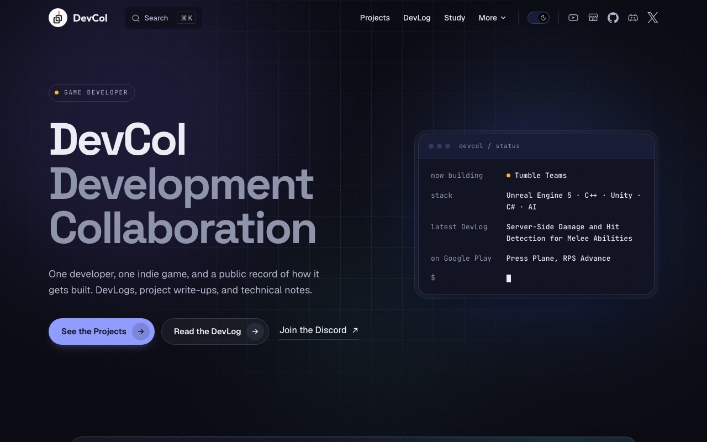

<div align="center">

<a href="https://devcol.net"></a>

# devcol.net

**DevCol — development collaboration.**<br>
Building indie games with the players, in the open.

[](https://devcol.net)
[](https://github.com/devcol-main/devcol-site/actions/workflows/deploy.yml)
[](https://vitepress.dev)
[](.nvmrc)

[Website](https://devcol.net) · [DevLog](https://devcol.net/blog/) · [Projects](https://devcol.net/projects/) · [Wiki](https://devcol.net/wiki/) · [Study](https://devcol.net/study/)

<a href="https://devcol.net"></a>

</div>

---

## About

This repo is the source of **[devcol.net](https://devcol.net)** — the home base for DevCol's game development.
It's a lightweight static hub: the place where devlogs, project write-ups, and game design docs live, and where traffic from YouTube, Discord, and X lands.

| Section | What's inside |
|---|---|
| 📝 **DevLog** | Development diaries grouped by project — PSEUDO, TumbleTeams, Arcade Web |
| 🎮 **Projects** | Portfolio pages for UE5 / Unity games, web games, and AI-assisted tools |
| 📚 **Wiki** | Design docs for **PSEUDO** — dice, combat, weapons, damage, elements, stats |
| 🧪 **Study** | Unreal Engine & tooling notes with pitfalls, full code, and checks |
| 🕹️ **Arcade** | Playable browser games (Stack Up, Bug Squash) served from `docs/public/games/` |

## Tech stack

| | |
|---|---|
| **Generator** | [VitePress](https://vitepress.dev) + custom Vue theme |
| **Animation** | [GSAP](https://gsap.com) |
| **Fonts** | Geist · Space Grotesk · Outfit · JetBrains Mono (Fontsource) |
| **Hosting** | GitHub Pages, deployed by GitHub Actions |
| **Domain / DNS** | Cloudflare Registrar + Cloudflare DNS |
| **Cost** | Domain fee only — hosting, DNS, and SSL are free |

## Getting started

Requires **Node 24** (see [`.nvmrc`](.nvmrc)).

```bash
npm install
npm run docs:dev      # dev server → http://localhost:5173
```

| Script | What it does |
|---|---|
| `npm run docs:dev` | Start the local dev server with hot reload |
| `npm run docs:build` | Build the static site into `docs/.vitepress/dist` |
| `npm run docs:preview` | Preview the production build locally |
| `npm run schedule` | Dry run: list scheduled posts that are still hidden |
| `npm run docs:build:ci` | CI build — applies scheduled publishing, then builds |

## Project structure

```text
devcol-site/
├── docs/
│   ├── .vitepress/
│   │   ├── config.mts        # nav, sidebar, local search
│   │   └── theme/            # custom theme: home page components, footer, data loaders
│   │       └── site.ts       # "Now building" project, hero phrases, social links
│   ├── blog/                 # DevLog posts (grouped by project)
│   ├── projects/             # portfolio pages
│   ├── wiki/                 # PSEUDO design docs (lore, systems)
│   ├── study/                # study notes
│   ├── public/               # static assets, web games, CNAME
│   └── index.md              # landing page (<HomePage />)
├── scripts/schedule.mjs      # scheduled publishing
└── .github/workflows/deploy.yml
```

## Scheduled publishing

Add `publishAt` to a page's frontmatter to keep it hidden until that day (Asia/Seoul):

```yaml
---
title: My next devlog
publishAt: 2026-10-25
---
```

Before each CI build, `scripts/schedule.mjs` removes pages that aren't due yet and strips every link to them, so the build has no dead links.
The deploy workflow also rebuilds **daily at 09:00 KST**, so scheduled pages go live on their day without a push.

```bash
npm run schedule                                   # what's hidden right now
node scripts/schedule.mjs --today 2026-10-25 --dry # pretend it's another day
```

## Deployment

Push to `main` → [GitHub Actions](.github/workflows/deploy.yml) builds and deploys to GitHub Pages automatically.

<details>
<summary><b>First-time repo setup (one-off)</b></summary>

1. Repo **Settings → Pages → Source**: `GitHub Actions`.
2. Repo **Settings → Pages → Custom domain**: `devcol.net`.
   (`docs/public/CNAME` already contains `devcol.net`, so it survives redeploys.)
3. Cloudflare DNS for `devcol.net`:
   - 4× `A` records for `@` → `185.199.108.153`, `185.199.109.153`, `185.199.110.153`, `185.199.111.153`
   - 1× `CNAME` record: `www` → `<your-github-username>.github.io`
   - Set them to **DNS only** (grey cloud), not proxied, or GitHub's SSL issuance can fail.
4. Wait for GitHub Pages to issue the certificate (up to ~24h, usually faster), then enable **Enforce HTTPS**.

</details>

## Connect

<div align="center">

[](https://www.youtube.com/@devcol)
[](https://discord.gg/7YTgpP8CCt)
[](https://x.com/DevCol_Main)
[](https://devcol.itch.io)

<sub>© DevCol · Site content and game designs belong to DevCol.</sub>

</div>
