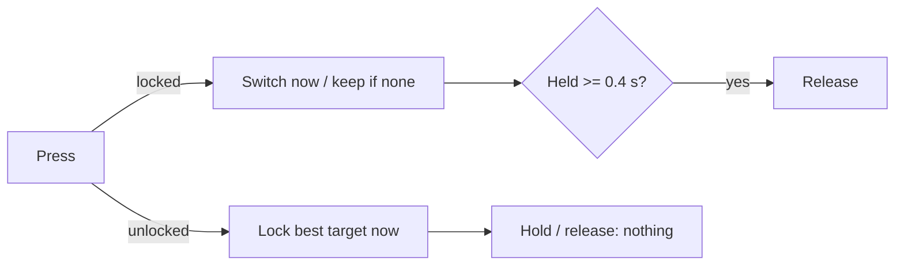

# A Lock-On That Waited for the Release: Moving a UE5 Input Tap Decision to the Press

PSEUDO's lock-on sits on the mouse wheel click (R3 on a gamepad). With a melee weapon out, a click locks on to the enemy in front of you, another click switches to a different target, and holding the key releases the lock. (The layout is on the [Controls](/wiki/pseudo/systems/controls#lock-on) page.)

My complaint after a play session was short: lock-on doesn't work well. When I click the wheel I expect to be locked on right away, and often I wasn't. Sometimes it came a beat late, and sometimes it never came.

The cause turned out to be a timing rule I had written myself, and the reason I hadn't caught it was the way I tested it.

## The symptom

- **Expected**: every click locks on at once to a valid target in front. A second click switches, or keeps the lock if there's only one target. A hold releases.
- **Observed**: clicks that did nothing, and clicks that locked a little after I'd let go.
- **Repro**: `L_Test_Combat`, PIE listen server plus one client, enemies frozen, the player 500 cm in front of a training dummy, melee or unarmed. Hold the wheel click for 0.35 s or 0.5 s: no lock, and no log line at all.

## What I ruled out

| # | Hypothesis | How I checked | Result |
|---|---|---|---|
| 1 | An input trigger (Hold / Pressed) on the action or the mapping context eats the release | Neither `IA_LockOn` nor `IMC_Default` has any trigger classes; the character binds Started, Triggered and Completed directly | Ruled out |
| 2 | The lock is judged on release, inside a narrow tap window | Old build, injected presses of different lengths | **Confirmed** |
| 3 | The middle click doesn't reach the game (viewport or focus) | Real OS-level middle clicks (80 ms down) sent to the PIE windows | Ruled out: 9 of 10 per window, and the one lost click was the first after switching PIE windows |
| 4 | The target query rejects a valid target (range, line of sight, dead) | Log lines for "none in range" and out-of-sight | Ruled out: zero of either, with the dummy 500 cm in front |
| 5 | The server rejects the client's lock | Client log | Ruled out: each local lock is followed by the server's, zero rejections |
| 6 | With pistols out, the same key opens the ammo wheel instead | Pistols drawn, press | By design, kept |
| 7 | Frame hitches turn a tap into a hold | Frame times during all trials | Ruled out: 16-20 ms throughout |

Hypothesis 3 is the one I expected after the [menu input bug](./2026-10-22-pseudo-menu-start-no-control), where real keys were dropped by the viewport. Not this time. The lost first click after focusing another PIE window is the editor using that click to focus the window; it happens in the old build as well, so I just discard it when counting.

Hypothesis 2 showed up clearly in the baseline. Injected presses of one frame, 0.1 s and 0.2 s all locked, but only **after the release**, 0.10 to 0.24 s after the press. Presses of 0.35 s and 0.5 s never locked and logged nothing.

## The cause

The lock-on component split the work across press, hold and release:

- `InputPressed` only stored the press time.
- `InputReleased` did the lock or switch, but only if the key had been down for no more than `LockOnTapTime` (0.3 s).
- `InputHeld` released the lock at `LockOnHoldTime` (0.4 s), but did nothing if you weren't locked.

```cpp
// old flow (removed)
void UPseudoLockOnComponent::InputReleased()
{
	const double HeldFor = PressTime >= 0.0 ? RealNow() - PressTime : 0.0;
	...
	// A hold was a release; a press between tap and hold does nothing
	if (bWasHandled || HeldFor > GetDefault<UPseudoCombatSettings>()->LockOnTapTime)
	{
		return;
	}
	// lock / switch here
```

So every lock waited for the key to come up: about 0.1 s for a quick tap, longer for an ordinary click. And from an unlocked state, a click held 0.3 s or longer did nothing at all. Between 0.3 and 0.4 s it was too long to be a tap and too short to be a hold, and past 0.4 s the hold only knew how to release a lock that didn't exist. A mouse wheel button is stiff, and a deliberate click on it reaches 0.3 s easily.

The tap window came from the original lock-on design, where tap and hold on the same key had to be told apart. The only thing the hold actually does is release a lock, though, and that only matters when you're already locked.

## The fix

The lock and the switch now happen on the press. A hold only releases a lock that existed **before** that press, so a slow first click locks and stays locked.

```cpp
void UPseudoLockOnComponent::InputPressed()
{
	PressTime = RealNow();
	const bool bWasLocked = LockTarget != nullptr;
	bPressHandled = !bWasLocked;   // only an existing lock can be released by holding
	...
	if (!bWasLocked) { /* best target vs character forward -> SetLockTarget */ return; }
	/* switch: other target closest to the camera view, none = keep */
}
```

`InputHeld` is unchanged: at 0.4 s it releases, if the press didn't mark itself as handled. `InputReleased` now only resets state. `LockOnTapTime` is gone from the combat settings, since there's no tap window any more.



One side effect I accepted: holding from a locked state with a second target in range now switches on the press and then releases at 0.4 s. You end up unlocked, which is what the hold asked for.

With the pistols out, the key still opens the ammo wheel on the press and never locks. That's an earlier decision (no lock-on in ranged, because shots go where the crosshair points), and I left it alone.

## Checking it

Both builds compile. PIE listen server plus one client on `L_Test_Combat`, enemies frozen.

| Check | Result |
|---|---|
| Injected presses of 1 frame, 0.2, 0.35 and 0.5 s from unlocked; melee and unarmed; host and client | 16/16 lock and stay locked. Press to lock is about one frame (0.016-0.019 s, with two single-frame outliers of 0.049 and 0.125 s). The client's server line follows 12-15 ms later |
| Real middle clicks: 80 ms x4, 300 ms x3, 450 ms x3, per window and mode | 10/10 for host melee, host unarmed, client melee and client unarmed |
| Second click | Switches at once (`press: switch D1 -> D0`); with one target in range, `(no other target, kept)` |
| Hold 0.6 s from locked | `hold: release` |
| Pistols drawn | Ammo wheel opens on the press and closes on release, no lock |

The 300 and 450 ms real clicks are the important rows. In the old build, both lengths fell into the dead zone.

## A second report, same day

Later the same day I still had wheel clicks that did nothing, while `H`, a keyboard binding for the same action, always worked. Same symptom, so I went through it again:

- The mapping context: `IA_LockOn` is bound to the middle mouse button, `H` and the right stick press, with no triggers or modifiers on any of them. The wheel and `H` go through exactly the same path.
- Button chatter: the log had 35 `[local] press` lines, and the smallest gap between two of them was 217 ms. No double presses.

Every press that reached the game locked. So the remaining suspects sit before the game: the mouse itself, its software, or the first click after focusing the PIE window being swallowed. The way to tell is `showdebug enhancedinput` in PIE while clicking, which shows whether the press arrives at all. I haven't settled that one yet, but the code is no longer a suspect.

## What I took from it

**Judge on the press when the player expects "instantly".** Lock-on and interact are actions where any delay feels like a missed input. Release-judging belongs to keys that genuinely need tap and hold on the same press, like the dash key, and there the tap window should be generous.

**Vary the down time in input tests.** My tests used clean one-frame taps, and so did the baseline real clicks at 80 ms: both looked perfect. Nobody clicks a mouse wheel in one frame. Testing 80, 300 and 450 ms would have found this the day the tap window was written.

**When one key works and another doesn't, check the mapping first, then the hardware.** If both keys map to the same action with no triggers, the game can't treat them differently, and the question becomes whether the press arrives at all.
