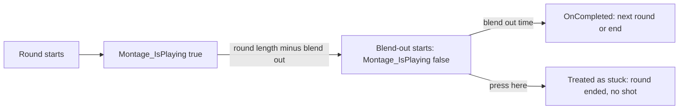

# My Safety Net Ended Healthy Shots: Montage_IsPlaying and the Blend-Out

Earlier the same day I fixed [a fire ability that could stay active forever](./2026-11-04-pseudo-ammo-switch-lost-presses) after an ammo switch cut its montage. Along with the real fix I kept a safety net: if you press fire while the fire ability is still active but its montage isn't playing, the ability logs `fire stuck` and ends itself, so the next press works.

Then a test with plain Shotgun taps, no ammo switching at all, produced `fire stuck` warnings. The safety net was firing on rounds that weren't stuck.

## The symptom

Shotgun, five presses 0.8 s apart: presses 2 and 4 logged this and fired nothing.

```
LogPseudoRangedFire: Warning: [client] BP_PseudoPlayerCharacter_C_0 fire stuck (montage AM_TB_Pistol_Fire_Heavy not playing, task set, round montage AM_TB_Pistol_Fire_Heavy, ammo Ammo.Shotgun, round 1, shot 1): ended
```

- **Expected**: no warning on a healthy round. A press during a round is simply ignored, and the round runs to its end.
- **Observed**: the round was ended early, and the press did nothing.

Note the message: the montage it says is "not playing" is the same one the round is playing. That was the giveaway.

## What I ruled out

| # | Hypothesis | How I checked | Result |
|---|---|---|---|
| 1 | Changes merged earlier that day (#225) caused it | `InputPressed` isn't in that diff, and the warning text is older than it | Ruled out as a code change (I didn't run a build from before it) |
| 2 | `Montage_IsPlaying` is false during the blend-out | Engine source, plus sampling on the client every tick | **Confirmed**: false at round start + 0.75 s, the ability's montage cleared at + 1.0 s |
| 3 | Only the Shotgun is affected | Press sweeps on five other ammo types | Ruled out: all of them, at the predicted times |
| 4 | Held fire is affected | Basic and HMG held for 5 s | Ruled out: a held key doesn't call `InputPressed` |
| 5 | The early end lets a shot skip the fire cadence | Shotgun: a press in the window, the next 0.05 s later | **Confirmed**: shots at 0.81 to 0.94 s instead of 1.0 s, all accepted by the server |

## The cause

This was the check:

```cpp
// PseudoGameplayAbility_RangedFire.cpp, InputPressed
UAnimMontage* Montage = GetCurrentMontage();
const UAnimInstance* Anim = ActorInfo ? ActorInfo->GetAnimInstance() : nullptr;
if (Montage && Anim && Anim->Montage_IsPlaying(Montage))
{
	return;
}
// logs "fire stuck" and ends the ability
```

`Montage_IsPlaying` looks the montage up with `GetActiveInstanceForMontage`, and a montage that has started blending out is no longer "active". But the fire round doesn't end at the blend-out. It deliberately waits for the montage task's `OnCompleted`, at the end of the blend-out, because ending at the blend-out would shorten the fire cadence. So there's a span at the end of every round where the round is healthy and `Montage_IsPlaying` says false:



The window is the blend-out time, in real seconds, before the end of the round. I predicted it for each ammo type from the montage numbers and then swept presses across it:

| Ammo | Round (s) | Blend out (s) | Predicted window (s) | Measured |
|---|---|---|---|---|
| Shotgun | 1.0 | 0.25 | 0.75 to 1.0 | Stuck from about 0.75 (onset 0.74 to 0.76); 1.02 is a new round |
| Basic | 0.283 | 0.10 | 0.183 to 0.283 | Stuck from 0.18; 0.31 is a new round |
| Element Fire | 0.747 | 0.20 | 0.547 to 0.747 | Stuck from 0.55; 0.76 is a new round |
| Grenade | 0.867 | 0.15 | 0.717 to 0.867 | Stuck at 0.75 to 0.85; 0.90 is a new round |
| HMG taps | 0.1 | 0.10 | the whole round | Stuck at 0.03 to 0.09; 0.12 is a new round |
| Laser | 1.2 | 0.25 | 0.95 to 1.2 | Stuck at 1.0 and 1.1; 1.3 is a new charge |

Every measured window matched the prediction. The HMG row is the worst case: its blend-out is as long as the round, so any tap during a round was treated as stuck.

That had two effects:

1. **A lost press.** The press did nothing and the round was cut short.
2. **A cadence skip.** Because the ability ended early, the next press started a new activation. The server keeps its "too fast" state per activation (it's reset in `ActivateAbility`), so it accepted a shot that came sooner than the round length allows. The Shotgun fired at 0.81 to 0.94 s instead of 1.0 s.

The safety net was supposed to catch one rare, real hang. Instead it fired on every ammo type, on presses that a player makes all the time.

## The fix

The check now asks for any instance of the montage, including one that's blending out:

```cpp
// DBG-030: any instance counts. Montage_IsPlaying is false during the blend-out, while the round waits for OnCompleted
if (Montage && Anim && Anim->GetInstanceForMontage(Montage))
{
	return;
}
```

A fire with no instance of its montage left is still caught, which was the real hang the net was built for.

I considered a second option: remember a press made during the window and fire the next round as soon as the current one completes. I didn't do it. Without it, a press during a round is ignored, which is how it always worked before the blend-out part. Whether early presses should queue is a feel question, so I'll decide it after playing.

## Checking it

| Check | Result |
|---|---|
| Shotgun sweep from 0.74 to 0.98 s, client and host | 0 `fire stuck`, 0 rejections; the press is ignored and the round reaches its end; presses at 1.02 and 1.05 s fire a second shot |
| Presses in the window on Basic, element Fire, grenade, HMG taps, Laser | 0 `fire stuck`, 0 rejections |
| Cadence: pairs at 0.80 + 0.85 and 0.90 + 0.95 s; a press every 0.05 s for 3 s | No early shot; the spam produced shots 1.01 and 1.04 s apart |
| Basic and HMG held 5 s | Same rate as before, 0 stuck |
| The hang sequence from the earlier bug, 10 times | `Activated` equal to `Ended` on both machines (20 each), every press fired |

Not covered: Ice and Poison (same code path as Fire), and the cadence skip on anything but the Shotgun. The host run was short, two repeats per gap.

## What's still open

During testing I stopped the client's fire montage from editor Python. The client's ability ended, but the server's copy never did, and every later press was rejected. It happened again after a PIE restart. The safety net isn't reached in that case, so this fix didn't cause it. My guess is that it's a test artifact, because commands sent from editor Python run locally, but I haven't verified that. An ammo-switch cut and a dash cancel didn't reproduce it. If a player's fire ever stops responding in real play, that's where I'll start.

Also noted for later: a modified client could still end and restart the fire ability on purpose to reset the server's per-activation cadence check. Hardening that is a separate job, if it turns out to matter.

## What I took from it

**A safety net needs the same care as the code it guards.** I wrote this check quickly, to catch a hang I'd already fixed properly, and didn't test it against normal play. It ran on every press, so its false positives cost more than the rare bug it was there to catch.

**"Playing" in the montage API excludes blending out.** `Montage_IsPlaying` uses the active instance, and a blending-out montage isn't active even though it's still on screen and the ability is still waiting on it. `GetInstanceForMontage` still finds it. This was the second time in one day that difference mattered; the first was in [the ammo switch blend](./2026-11-04-pseudo-ammo-switch-gun-dip).

**Predict the window, then measure it.** Working out each ammo type's window from its round length and blend-out time before sweeping presses made the test a yes-or-no check per row. Six rows that all matched were stronger evidence for the cause than any one log line.

**An early end is a server problem, not just a client one.** The lost press was annoying. The cadence skip was worse, because the server's rate check trusted the activation boundaries, and ending an activation early moved them.
