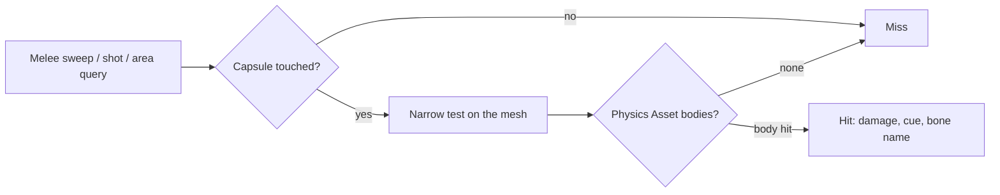

# Two Enemies Nothing Could Hurt: A Missing Physics Asset and a Two-Phase Hit Test

PSEUDO's enemies come from Paragon's minion pack: a lane melee minion, a ranged one, a siege one, and two larger "Buff" minions that I use as the Brute (red) and the Flyer (blue). The [Enemy AI](/wiki/pseudo/systems/enemy-ai) page has the roster. My combat test map has a few of each standing around so I can try weapons on them.

Two of them couldn't be hurt. The Brute and both Flyers ignored the greatsword, the pistols and area attacks. Every other enemy on the map took damage normally.

## The symptom

- **Expected**: damage on any enemy, like everywhere else.
- **Observed**: melee, shots and area attacks on the Brute and the Flyers did nothing.
- **Reproduce**: PIE, listen server, one player, attack one of them.

## What I ruled out (and what I confirmed)

| # | Hypothesis | How I checked | Result |
|---|---|---|---|
| 1 | These two enemies differ in their data | Listed the mesh and Physics Asset of every enemy data asset | **Confirmed**: the two Buff meshes were the only ones without a Physics Asset |
| 2 | The attack code depends on those bodies | Read the melee sweep, the shot narrow phase and the area narrow phase | **Confirmed** |
| 3 | The asset pack ships a Physics Asset I forgot to assign | Searched the Paragon Minions pack | Ruled out: there is none for the Buff meshes |
| 4 | Melee misses on the Flyer mean the new bodies are bad | Line-traced the mesh through the aim point (hit) and 4 m above it (miss), and read the Flyer's position after the swing | Ruled out: the Flyer climbs back to its 400 cm hover height even while enemies are frozen, and my test's hold callback was broken |
| 5 | The new Physics Asset makes corpses fall through the floor | Sampled the aim socket every 0.5 s after death | Ruled out (see below) |

## The cause

Every player attack in PSEUDO is two-phase. A broad query finds the enemy's capsule first, and then a narrow query tests only that mesh's Physics Asset bodies. The narrow phase is also what gives a hit its bone name.



For melee, the narrow phase is a sphere sweep against the component itself:

```cpp
// Sweeps only this component's Physics Asset bodies, so the result carries the bone
return Mesh->SweepComponent(OutHit, Start, End, FQuat::Identity, FCollisionShape::MakeSphere(Radius), false);
```

Shots use `LineTraceComponent` on the mesh, and area attacks go through the same bodies. A mesh with no Physics Asset has no bodies, so the capsule test passed and the narrow test missed every time, with nothing to say why. Most Paragon heroes ship without a Physics Asset. The other enemy meshes in my data already had one; the two Buff meshes never got one.

### A side finding: corpses keep falling after they're hidden

While checking hypothesis 5, I sampled the Brute's aim socket height after death: 152, 145, 78, 65, 62, 47, 41, 41, 40, 40, 40 cm, which is the body coming to rest on the floor. Then the corpse is hidden at about 5.5 s, and the samples go 15, -174, -605, -1301 and keep dropping.

That isn't caused by the new Physics Asset. Corpse removal turns off the actor's collision while the ragdoll is still simulating, so the hidden body falls through the world. Nothing shows on screen, and the path is shared by every enemy with a Physics Asset (I only sampled the Brute). The obvious cleanup is to stop the simulation when the corpse is removed. I've left it for now.

## The fix

**Physics Assets.** I generated one for each Buff mesh, 27 bodies for the Brute and 7 for the Flyer, saved them next to the meshes and assigned them.

**A lock-on socket.** In the same session I added a `LockOn` socket to every enemy mesh (on `spine_03` for the humanoid minions, the Brute, the Rampage boss and the training dummy, and on `body` for the Flyer). It's a mesh socket, not a skeleton socket, so each mesh gets its own. The lock-on marker now attaches to that socket when the target has one, and falls back to the old fixed point on the capsule otherwise:

```cpp
if (Mesh && Mesh->DoesSocketExist(PseudoLockOn::AimSocket))
{
	MarkerComponent->AttachToComponent(Mesh, FAttachmentTransformRules::SnapToTargetNotIncludingScale, PseudoLockOn::AimSocket);
}
```

Before, the marker sat at a fixed height on the capsule, which doesn't suit a tall Brute and a hovering Flyer equally. There's a side effect: the same target point also feeds the lock-on candidate check and the sight checks, so those now use the chest point as well.

## Checking it

PIE, combat test map, listen server, one player:

| Check | Result |
|---|---|
| Greatsword on the Brute | `took 16.8 from PseudoPlayerState_0`, bone `spine_03` |
| Pistol on a Flyer | `took 7.0 from PseudoPlayerState_0`, `1 hit(s) applied of 1 reported` |
| Pet drone on the Brute and a Flyer | Damage until death |
| Lock-on marker on a melee minion | Attached to the mesh's `LockOn` socket; its world position moved with the idle pose between two reads |
| Brute corpse | Comes to rest on the floor before it's hidden |

What I didn't test: melee on a Flyer (the one valid attempt ran with the pistols drawn), area attacks on either enemy, a Flyer corpse before it's hidden, a client attacker, and the marker during an attack animation. The fix also isn't in a commit yet.

One visual note from the screenshots: the white marker on the minion's chest is hard to see against its white armor. That's a separate polish item.

## What I took from it

**Every new enemy mesh needs a Physics Asset.** With a two-phase hit test, the capsule only decides whether the narrow test runs. Without bodies the enemy can't be hit at all, and nothing in the log says so. The Paragon Buff meshes don't ship one, so it's now a step on the checklist for bringing in any enemy.

**A new enemy also needs a `LockOn` socket**, or its marker stays at a fixed capsule height.

**Read the damage source before crediting the player.** The enemy damage log says who did it. In a test with the pet drone out, the drone can do most of the damage, so a line that says `from PseudoPlayerState` is the one that proves a player weapon works.

**Frozen doesn't mean still for a flyer.** Flyers return to their hover height even with enemies frozen, so a melee test that assumes the target stays where it was knocked will miss for reasons that have nothing to do with collision.
