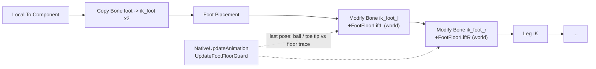

# Toes Sinking Into the Floor on the First Step and on Jumps in UE5: a Foot Floor Guard After Foot Placement

In PSEUDO the toes dipped into the floor on the first step out of Idle, on the stop, and worst of all on a jump take-off, where the whole foot went up to 19 cm under the ground. Foot Placement was already in the graph and didn't catch it. If your character does the same, the fix that worked for me is this: after Foot Placement, trace the floor under the ball of each foot and the toe tip in the last evaluated pose, and lift that foot's IK target by however deep it went. Leg IK then bends the knee and the foot stands on its ball. For the jump, start the jump-start clip past its push-off frames.

<figure class="theme-img">
  
  
</figure>

This came after an earlier round of foot bugs, written up in [Three Foot Bugs That Weren't Foot IK](./2026-11-02-pseudo-idle-foot-sink-dash-leg-drag). A retune of Foot Placement after that didn't fix this one, so I started by measuring.

## Measuring the sink frame by frame

Slow motion on screen shows that something is wrong but not by how much, so I wrote a small editor Python probe. On a flat test floor, at `slomo 0.2`, it records every frame the height of the `ball_*` bones, the `foot_*` bones and an estimated toe tip above a line trace to the floor under each point. The Twinblast skeleton the character uses has no toe bone, so the toe tip is the ball plus 9 cm along the ball bone. Standing idle, that estimate reads about 0.5 cm lower than it should, which is good enough.

The target I set: no visible sink at `slomo 0.2`, meaning the ball no more than 1.5 cm under the floor, without changing how fast the character starts or how fast it jogs.

The lowest values before the fix (cm, negative is under the floor):

| Case | DualPistols ball / toe | Greatsword ball / toe | Unarmed ball / toe |
|---|---|---|---|
| First step from Idle | **-10.3 / -15.0** | -4.0 / -7.7 | -4.5 / -8.3 |
| Stop (Jog -> Idle) | -7.1 / -7.9 | -3.2 / -4.3 | -3.3 / -5.2 |
| Steady jog (reference) | -0.8 / -2.0 | -1.7 / -2.0 | -1.6 / -3.4 |
| Jump take-off | **-18.0 / -23.5** | -18.9 / -22.1 | -19.3 / -24.9 |
| Landing, jump in place | -4.8 / -8.2 | -7.1 / -10.6 | -6.4 / -10.1 |
| Landing, run + jump | -6.9 / -9.8 | -6.1 / -8.4 | -6.4 / -9.0 |

Steady jogging is fine, so the clips themselves are fine. The trouble is in blends (Idle to Jog, Jog to Idle, into and out of the air), and it shows up with every weapon. The take-off is far worse than anything else.

## Why a jump-start clip puts the feet 18 cm underground

I read the ball height relative to `root` straight out of the three jump-start clips (`AnimPoseExtensions`, 30 fps):

| Clip time (s) | 0.00 | 0.03 | 0.07 | 0.10 | 0.13 | 0.17 | 0.20 | 0.23 | 0.30 |
|---|---|---|---|---|---|---|---|---|---|
| DualPistols `TB_Jump_Start` | 0 | -20 | -40 | -46 | -36 | -22 | -13 | -11 | -12 |
| Sword `TB_Jump_Start` | -2 | -21 | -39 | -46 | -33 | -23 | -15 | -9 | +8 |
| Unarmed `TB_Jump_Start_TravelMode` | 0 | -20 | -40 | -47 | -37 | -23 | -13 | -11 | -12 |

The clips push the feet down while the root rises. That works when the root lifts with the push. In my game the capsule leaves the ground at about 490 cm/s right away, and Foot Placement is off in the air, so for about 0.05 s the push-off frames put the whole foot 12-18 cm under the floor it just left.

The fix for that part is one value. In the Animation Blueprint's `Jump` state, the Sequence Player for the jump-start clip now has a **Start Position of 0.2 s**. All three clips share the same push-off curve, and by 0.2 s their feet are back near the root.

## One guard for every blend instead of start clips

For the ground blends, the textbook answer is a Start state with dedicated start clips. I didn't build it. The sink isn't only on the first step; it's also on the stop and the landing, so start clips would fix one case of four. The Greatsword has no start clips of its own and would need some retargeted. And a new state changes start latency, because the movement component's acceleration and the clip's pacing have to agree.

What I built instead sits in the AnimGraph between Foot Placement and Leg IK:



Two **Modify Bone** nodes move `ik_foot_l` and `ik_foot_r` up by an additive world-space translation. The amounts come from the C++ anim instance, which works them out on the game thread in `NativeUpdateAnimation`. Leg IK then solves to the raised target, so the knee bends, the toe rests on the floor and the heel stays up. On a push-off foot that reads as standing on the ball.

I lift the target instead of pitching the toe up because the ankle goes under the floor too: -4.9 cm on the first step, -13 cm on take-off. Rotating around an ankle that's already underground can't fix that. Lifting by the depth of the lowest point always does.

## Reading a pose that is one frame old

The cleanest place for this check is inside the animation evaluation, as a Control Rig or a custom anim node. Both would add new engine module dependencies to the game module, and I didn't want that for this change. So the guard reads the last evaluated pose on the game thread, which is one frame old, and that leads to three details:

- **Take out the last lift first.** The last pose already has last frame's lift in it. Measuring it as is would see the foot as fine and drop the lift, and next frame it would sink again. So the probe points are moved back down by the applied lift before the traces.
- **Lead a sinking foot a little.** While a foot keeps going down, the guard adds the last frame's step once more (at most 3 cm). It skips that on the first frame of a sink: on a remote player's copy, a sudden speed jump made the foot hover for a while.
- **Up at once, down eased.** The lift rises to the target in one frame and falls back with `FInterpTo` (`FootFloorReleaseSpeed` 12), so the toe doesn't pop when it comes out of the floor.

```cpp
// MeasureFootFloorDepth: the last pose still carries the last lift, take it out first
const FVector Undo(0.f, 0.f, Applied);
const FVector BallPos = Ball.GetLocation() - Undo;
...
for (const FVector& Point : { BallPos, Toe })   // trace from above the ankle down past the point
	if (World->LineTraceSingleByChannel(Hit, Start, End, ECC_Visibility, Params) && !Hit.bStartPenetrating)
		Depth = FMath::Max(Depth, Hit.ImpactPoint.Z - Point.Z - FootFloorTolerance);

// UpdateFootFloorGuard, per foot
Target = Depth + (LastDepth > 0.f ? FMath::Clamp(Depth - LastDepth, 0.f, 3.f) : 0.f);
Target = FMath::Clamp(Target, 0.f, FootFloorMaxLift);
const float Z = Target >= Applied ? Target
	: FMath::Max(Target, FMath::FInterpTo(Applied, Target, DeltaSeconds, FootFloorReleaseSpeed));
Lift = FVector(0.f, 0.f, Z);   // read by the ABP's Modify Bone (ik_foot_*, additive, world space)
```

The rest is about not lifting in the wrong place. Each trace starts 30 cm above the higher of the ankle and the probe point, so a ledge above the foot (a mantle, a ladder top) never counts as the floor. It uses simple collision on `ECC_Visibility`, the same collision Foot Placement uses. The guard only runs while walking or falling, so ladders, mantles, swimming and sliding keep their own poses. A foot has to be more than 1 cm under (`FootFloorTolerance`) before anything happens, and the lift is capped at 30 cm. Nothing is replicated: each machine animates its own copies of every character and traces its own world. A console variable, `pseudo.Anim.FootFloorGuard 0/1`, switches it off for A/B checks.

## What the numbers said afterwards

Same probe, same floor, `slomo 0.2`. The numbers are the lowest ball / toe tip in cm, with the count of frames below -1.5 cm in brackets:

| Case | DualPistols before -> after | Greatsword before -> after | Unarmed before -> after |
|---|---|---|---|
| First step | -10.3 / -15.0 (28, 50) -> **-1.0 / -1.1 (0, 0)** | -4.0 / -7.7 (66, 83) -> **-1.3 / -1.2 (0, 0)** | -4.5 / -8.3 (27, 99) -> **-0.7 / -1.4 (0, 0)** |
| Stop | -7.1 / -7.9 (19, 20) -> -1.7 / -2.5 (2, 2) | -3.2 / -4.3 (31, 35) -> -1.0 / -1.7 (0, 1) | -3.3 / -5.2 (25, 44) -> -0.1 / -2.5 (0, 2) |
| Steady jog | -0.8 / -2.0 (0, 34) -> -0.8 / -1.2 (0, 0) | -1.7 / -2.0 (35, 40) -> -1.1 / -1.3 (0, 0) | -1.6 / -3.4 (8, 116) -> -0.6 / -1.5 (0, 0) |
| Jump in place (take-off; landing) | -18.0 / -23.5; -4.8 / -8.2 (25, 31) -> **-0.1 / -2.0; -0.1 / -2.4 (0, 4)** | -18.1 / -21.3; -7.1 / -10.6 (28, 34) -> **-0.5 / -0.8; -0.6 / -2.5 (0, 3)** | -19.3 / -24.7; -6.4 / -10.1 (29, 37) -> **-0.1 / -0.9; -0.0 / -3.6 (0, 2)** |
| Run + jump (take-off; landing) | -18.0 / -23.6; -6.9 / -9.8 (23, 38) -> **+0.6 / -1.0; -0.1 / -2.2 (0, 2)** | -18.9 / -22.1; -6.1 / -8.4 (38, 56) -> **+3.2 / -0.5; -1.0 / -2.4 (0, 4)** | -19.3 / -24.9; -6.4 / -9.0 (26, 68) -> **0.0 / -0.9; -0.2 / -1.5 (0, 0)** |

The ball stays within 1.5 cm in every case except the DualPistols stop, which has two frames at -1.6 and -1.7. The toe tip goes past -1.5 only on 0-4 single frames per case, out of 285-465 frames. Those are the first frames of a sink, the ones the one-frame-old pose can't see yet. The worst is -3.6 cm on one unarmed landing frame. At normal speed (`slomo 1`) the lag shows up as a single 16 ms frame at the start of a sink, and the take-off is clean.

Movement didn't change. First capsule movement after the input stayed at 1.504-1.506 s of game time, 90 % of jog speed arrived at the same time (DualPistols 1.722 s before and after), and jog speeds stayed at 500 / 500 / 750. The guard only touches the pose.

On a listen server with one client, both players stepping off, jogging, stopping and jumping together, both machines show the guard on the other player. With the guard off (jump start position already at 0.2), the worst ball was -6.5 cm; with it on, -1.4 cm on the host's own character, the client's own character and the client's pawn on the server. The host's copy on the client did a little worse, -3.7 / -4.9. Its speed arrives in steps (194 to 115 cm/s in one frame on the stop, for example), so the pose jumps for a frame before the guard catches up.

## Trying it in your own project

To check whether you have this: put the character on a flat floor and log, every frame, the height of the ball bones (and an estimated toe tip if you have no toe bone) above a floor trace. Do it at a slow `slomo` through start, stop, jump and landing. If steady locomotion is clean but blends and jumps go under, the clips aren't the problem, the blends are.

The fix, without any of my code:

1. Between your foot placement or ground IK and your leg IK, add a Modify Bone per IK foot bone: additive translation, world space, driven by a float variable.
2. In the anim instance's update, take the last pose, subtract the lift you applied last frame, trace down from above the ankle to just past the ball and toe tip, and set the lift to the depth beyond a small tolerance. Raise it at once, ease it down, cap it, and only run it in walking and falling.
3. If your jump-start clip pushes the feet below the root while the capsule is already airborne, raise the Sequence Player's Start Position until the feet are back near the root.

## Still open

- Single onset frames. The lift lands one frame late, so the toe tip can still dip up to about 3.6 cm at `slomo 0.2` and about 6 cm on a full-speed stop. Getting rid of them means doing the check inside the animation evaluation, with a Control Rig or a custom anim node. I haven't decided whether it's worth the extra dependency.
- Start clips. The guard already removes the first-step sink, so start clips would only be for the look. They'd also change start latency.
- A stiffer take-off. The crouch-and-push is gone from the jump start. If it looks too stiff, 0.15 s is the next value to try. The feet are about 22 cm under the root there, and the guard would lift them.
- Untested ground. No run checked stairs, ramps, ladders, mantles, swimming or sliding. The guard is off outside walking and falling and its traces start above the ankle, but I still want to look at steps and slopes in play. The look of a lifted push-off foot hasn't had a careful visual pass yet either.
