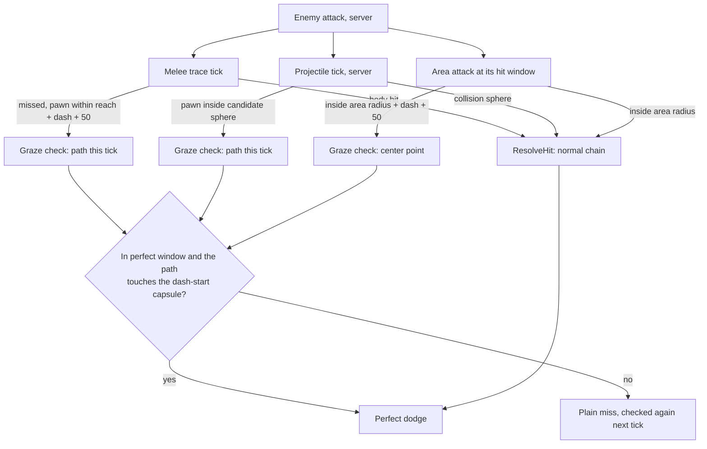

# A Perfect Dodge That Never Gets Hit: Judging Backward Dodges From the Dash Start With FMath::SegmentDistToSegmentSafe in UE5

If your perfect dodge is judged inside the hit pipeline, a backward dodge can never be perfect: the player dashes out of reach, the attack misses, and the code that would have rewarded the dodge never runs. In PSEUDO I fixed this with one question asked on the server when an attack misses: would it have hit the spot where the player stood when the dash started? If yes, and the dash started inside the perfect window, it counts. The check is a segment-to-segment distance between the attack's path this frame and the axis of the player's capsule at the dash start. This post covers how that check plugs into melee sweeps, projectiles and area attacks, why my first, simpler version failed, and the ammo changes that shipped with it, including a dry-fire click that had to be replicated by hand.

<figure class="theme-img">
  
  
</figure>

The defense rules themselves (windows, rewards, the order guard, parry and dodge are checked in) are on the wiki's [Defense](/wiki/pseudo/systems/defense) page, and the server-side timing they rely on is in [Fair Parry and Dodge Windows on a UE5 Listen Server](./2026-11-17-pseudo-server-judged-parry-dodge). The reward a perfect dodge triggers, a short slow motion, is in the [Glitch Time build log](./2026-11-25-pseudo-glitch-time-perfect-dodge-slow-motion).

## Why a backward dodge earned nothing

PSEUDO's defense component (a component on the player pawn that owns guard, parry and dodge) judged everything in one function, `ResolveHit`, called when an enemy attack touched the player. It compares the hit time with the stored dash time and returns a perfect dodge if the dash started inside the window.

That works for a dodge in place or to the side, where the attack still overlaps the player during the invulnerable dash. A backward dash is different. The player leaves the reach, the attack touches nothing, `ResolveHit` is never called, and the best-timed dodge in the game gets the same result as walking away early.

So I needed a second path for misses. The rules I settled on:

- A miss counts only inside the perfect window, and only if the attack would really have hit. A dodge that was early, or one against an attack that was never going to reach, is a plain miss with no reward.
- It applies to every enemy attack type: parryable, unblockable and dodge-only.
- A body hit always wins over a graze in the same frame, and one attack answers one target once.

## Attempt one: a wider margin, measured where the player is now

The first version was a "margin graze": if the attack missed by up to 150 cm while the player was inside the perfect window, count it. It was simple, and it passed the melee test only after I shortened the dash to 150 units.

With the default dash of about 450 units the player was roughly 340 cm away from the attacker when the swing arrived, far outside the reach plus 150 cm. A margin measured from the player's current position is really a test of how short the dash is. Making the margin big enough would also reward dodges against attacks that were never close. A second problem showed up too: perfect dodges that happened in reach mostly logged as grazes, because the wide sweep touched first.

## Attempt two: would it have hit the dash start?

The final rule ignores where the player is now and asks about where they were. When the dash begins, the server already stores the dash time (from the client's release time, clamped by the 0.15 s grace). It now also stores the pawn's server position, `DashStartLocation`.

On a miss inside the window, the defense component reduces the capsule at that spot to its vertical axis segment and measures the closest distance between that segment and the attack's path this frame. `FMath::SegmentDistToSegmentSafe` gives the two closest points; their distance is compared against the attack radius plus the capsule radius plus a margin of 50 cm:

```cpp
const FVector AxisTop = DashStartLocation + FVector(0.f, 0.f, AxisHalf);
const FVector AxisBottom = DashStartLocation - FVector(0.f, 0.f, AxisHalf);
FVector OnAttack;
FVector OnCapsule;
FMath::SegmentDistToSegmentSafe(SegmentStart, SegmentEnd, AxisBottom, AxisTop, OnAttack, OnCapsule);
const float Distance = FVector::Dist(OnAttack, OnCapsule);
const float Reach = Radius + CapsuleRadius + GetDefault<UPseudoCombatSettings>()->PerfectDodgeGrazeMargin;
const bool bTouched = Distance <= Reach;
const bool bPerfect = bInWindow && bTouched;
```

A capsule is a segment with a radius, and a swept sphere is a segment with a radius, so the whole test is one distance between two segments. No physics query is needed for the exact answer.

The margin (`PerfectDodgeGrazeMargin`) and an on/off switch (`bPerfectDodgeGraze`) live in the project's combat settings. Both `ResolveHit` and the new `ResolveGraze` read the same window helpers, so the perfect window and its Luck bonus mean the same thing for hits and misses.

## Feeding it from three kinds of attack

The exact check is cheap, but it needs candidates: which players could have been grazed this frame? Each attack type finds them with a wide, cheap query sized to the farthest a dash can carry someone: attack radius + `DashDistance` + 50 cm.



- **Melee sweeps** already ran two sweeps per tick. The hit pass runs first; the graze pass runs after it on the wider candidates, so a body hit always wins. The path for the check is the blade's trace segment for that tick.
- **Projectiles** got a server-only candidate sphere. My first try only checked on sphere enter and exit events, and it missed: the candidate sphere is large and the perfect window is short, so by the time the enter event fired the window was often gone. While grazing is enabled, projectiles now tick on the server and check candidates along this frame's path.
- **Area attacks** have no path, so the segment collapses to a point (start equals end). The test becomes "was the dash-start capsule within the area radius of the center".

A graze outside the window is not recorded at all. That matters for melee: the same swing keeps sweeping, and if the player wanders back into it later, it can still hit normally.

On the enemy attack side, a graze goes through the same function as a hit with an extra radius argument. Anything that is not a perfect dodge returns as a miss:

```cpp
const bool bGraze = GrazeRadius >= 0.f;
if (bGraze)
{
	const EPseudoDefenseResult Grazed = Defense ? Defense->ResolveGraze(Hit.TraceStart, Hit.TraceEnd, GrazeRadius) : EPseudoDefenseResult::None;
	if (Grazed != EPseudoDefenseResult::PerfectDodge)
	{
		return EPseudoDefenseResult::None;
	}
}
```

That keeps one reward path. A graze triggers exactly what an in-reach perfect dodge does: the gameplay event that charges dice pips and refills ammo, the slow motion, and closing the target for that attack.

All of this runs only on the server. Clients see the result through the gameplay cues that were already there.

## What the tests showed

With the default 450-unit dash and the 50 cm margin, on a listen server with one client:

- Melee backward dodge: `since dash 0.000, 57 cm from the dash start (reach 129) -> PerfectDodge (graze)`, one answer, ammo refill, a dice pip and the slow motion.
- Projectile, side and back: `since dash 0.033, 102 cm ... -> PerfectDodge (graze)`, and the rock flew on. A control run with no dash took 15.6 damage.
- Area slam: a dodge that ended outside the area logged `52 cm ... (reach 334) -> PerfectDodge (graze)`; one that stayed inside went through the normal hit path as a perfect dodge.
- An attack that would not have reached the dash start (300 cm away): the closest in-window check was 186 cm against a reach of 129, so nothing happened.
- An early dash got nothing; no dash took a normal hit; in-place and side perfect dodges still gave exactly one answer.
- On the client, the backward perfect dodge was judged by the server and the client got its cues.

To see it in the editor, a debug console variable draws the dash-start capsule and the attack path: green for perfect, yellow for touched outside the window, grey for missed.

## Ammo that comes with a perfect dodge, and a click when it runs out

A perfect dodge already refilled the basic pistol ammo. With the pistols drawn it now also adds one round to the selected special ammo type, up to a new per-type `MaxStock` (default 10, 0 means no cap). Cheats and starting stock ignore the cap. Two rules around empty ammo changed with it:

- An emptied special type stays selected instead of falling back to basic ammo, so the next perfect dodge refills the thing you were using. Cycling to the next type still skips empty ones.
- Pulling the trigger at 0 no longer does nothing. It plays a short dry-fire montage (the first five frames of the fire animation) with a click sound on a notify. Holding the trigger through the last round gives exactly one click, then the press ends.

The fire ability's cost check now lets an empty press through, and activation branches early:

```cpp
// Empty: click instead of shooting (a charged type does not charge first)
if (!CanAffordShot(*Ammo))
{
	PlayDryFire();
	return;
}
```

### Why other players never saw the dry fire

The first test passed on the shooting client and failed for everyone else. A real shot sends target data to the server, the server's copy of the ability plays the montage, and the Ability System Component replicates it. A dry fire sent nothing, so the server never played the montage and nothing replicated.

The fix reuses the shot channel: a remote client's dry fire sends a marker shot with no hits and a sentinel value in its marker field. The server copy checks that the ammo really is empty on its side too, then plays the same montage, which replicates like any other. In the retest the server's dry fire followed the client's 17 ms later, the host saw the client's click and the client saw the host's, real shots were unchanged, and there were no rejected-shot warnings.

### Auto-stow during a long burst

One more bug turned up in feedback: the pistols put themselves away right when the ammo ran out. Auto-stow counted only the fire press as combat input, so five seconds of holding the trigger with no enemy nearby looked like five idle seconds. It now treats an active fire ability as busy. A held burst of 5.1 s (34 shots) kept the pistols out; they stowed about 5.4 s after the click.

## How to check your own perfect dodge

- **Test the backward case on purpose.** Dodge straight back from a swing with good timing. If nothing happens, your judgment lives in the hit path only.
- **Do not widen the hit to catch it.** A bigger margin measured from the current position rewards short dashes and attacks that were never close.
- **Store the position at dash start on the server**, next to the dash time you already store, and judge misses against that spot.
- **Reduce both shapes to segments.** Capsule axis vs swept path, `FMath::SegmentDistToSegmentSafe`, compare against the sum of the radii plus a small margin. Area attacks are the same test with a zero-length path.
- **Check every tick of the window.** Overlap enter and exit events are too coarse for a window this short.
- **Run hits first, grazes second, and route a graze into the same reward path as a hit**, so nothing is granted twice.
- **If an ability can end without sending target data, check what other machines see.** A montage the server copy never plays will not replicate.
